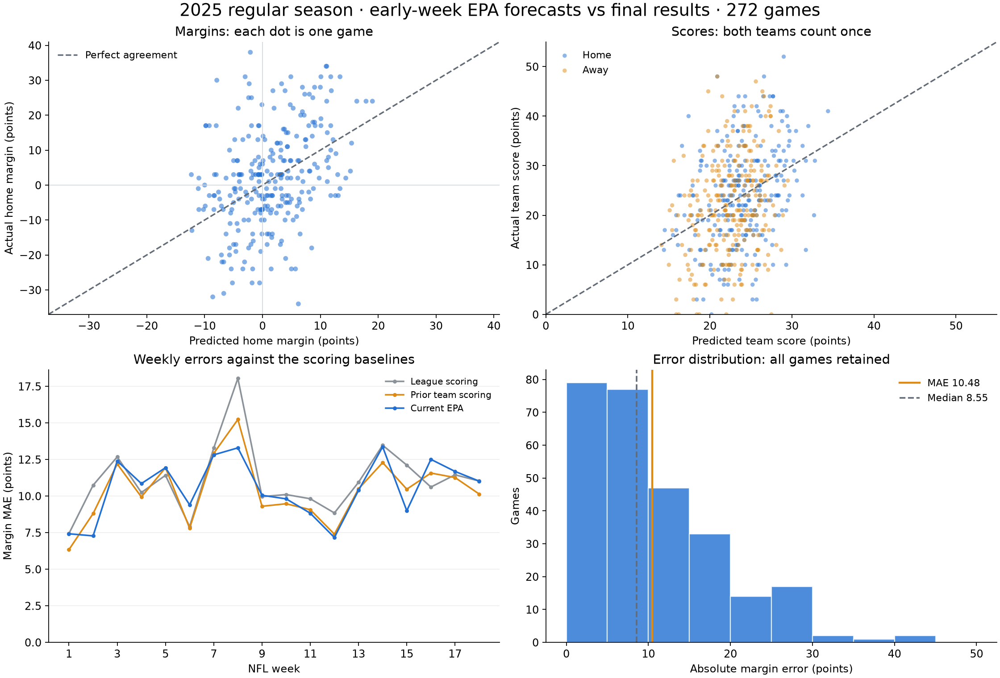

# Why is margin error high? 2025 diagnostic

October 14, 2026. Current EPA score model and two scoring controls, 272 completed regular-season
games per horizon, 144 chronological cutoff groups. Hyperparameters and features are unchanged.
Every training/feature input precedes the forecast under the kickoff-plus-24-hour assumption.
This is previously accessed diagnostic data, not a fresh holdout. All games remain in the metrics.

## What the comparison shows

| Model | Early margin MAE | Refresh margin MAE | Early score MAE | Refresh score MAE |
|---|---:|---:|---:|---:|
| League scoring | 11.060 | 11.059 | 7.875 | 7.875 |
| Prior team scoring | 10.328 | 10.315 | 7.519 | 7.515 |
| Current EPA | 10.483 | 10.447 | 7.559 | 7.540 |

EPA improves on the league control but has a slightly worse point estimate than prior scoring.
The early EPA-minus-prior MAE difference is +0.154 points, with approximate paired season-week
resampling range [-0.287, +0.556]; the refresh difference is +0.132 [-0.300, +0.527]. These
ranges include zero, so the small ordering does not establish a reliable advantage for either.
Resampling uses 5,000 week-block samples and seed 20261014; serial dependence and repeated
development access are not corrected. The original 2022–2024 EPA MAE was 9.811/9.805.

The complete interactive HTML contains both horizons: predicted/actual margin and score
scatterplots, weekly baseline comparisons, team/week heatmaps and selectable team trajectories.
Reproduce with `nfl-prop team-diagnose --season 2025`; the HTML and complete CSV are under
ignored `reports/local/team_diagnostics_2025/`. Tracked summaries retain hashes and exact metrics.

## Supported descriptions and plausible explanations

1. **Blowouts create much of the error, but it is not only a few outliers.** The 49 games
   decided by 21+ points are 18.0% of the season and contribute 37.6% of early absolute error,
   averaging 21.90 points of error. The 135 games decided by seven or fewer average 5.65;
   the 88 other games average 11.53. The largest ten errors contribute only 11.4% overall.
   Median absolute error is 8.55 and the 90th percentile is 22.89. Actual-margin groups are
   postgame descriptions, not pregame filters or a reason to remove games.
2. **Known starter/lineup changes are missing from the published model.** At the Week 5
   refresh, Baltimore was still projected +6.1; the final margin was -34 (Houston 44–10).
   Baltimore's official October 3 article ruled Lamar Jackson out and identified Cooper Rush
   as the replacement before that refresh. It was published after the September 30 early-week
   cutoff, so it does not establish a confirmed Out status at the early forecast. This case
   motivates systematic forecast-time starter-change coverage, without proving its aggregate
   accuracy effect. The earlier generic injury-count experiment had weak early coverage and
   did not support promotion. [Official Ravens report](https://www.baltimoreravens.com/news/lamar-jackson-hamstring-injury-sidelined-ravens-practice).
3. **Scoring swings include events that historical EPA averages cannot specify in advance.**
   Minnesota was projected -2.1 against Cincinnati in Week 3 and won 48–10 (+38), a 40.1-point
   miss. Its official report documents two defensive touchdowns by Isaiah Rodgers. Those
   realized events help describe the miss; inserting current-game turnovers/returns into a
   predictive model would be leakage. Test earlier-known turnover tendencies and special-teams
   context systematically rather than treating those two future touchdowns as known inputs.
   [Official Vikings report](https://www.vikings.com/news/isaiah-rodgers-touchdowns-forced-fumbles-defense-bengals-week-3).
4. **Prior EPA adds limited predictive signal in this specification.** Early margin
   correlation is 0.369 and diagnostic R² is 0.129. A useful test is whether nonlinear
   matchup interactions or a different loss improve chronological validation. The currently
   published Ridge model minimizes squared error with an L2 penalty, while MAE is the user's
   main target; median/absolute-loss models merit a controlled comparison. This is a hypothesis,
   not evidence that another algorithm will improve accuracy. [Ridge objective](https://scikit-learn.org/stable/modules/generated/sklearn.linear_model.Ridge.html).

## Explanations the data does not establish

- Forecast margins have standard deviation 6.27 points, versus 14.15 for actual margins.
  That compression is expected when forecasting averages and does not alone prove too much
  shrinkage. The descriptive actual-on-predicted slope is 0.832, with approximate week-block
  range [0.550, 1.140], including 1. It does not justify blindly expanding every margin.
- A small global bias does not explain the entire MAE: home-margin bias is only -0.58 points.
- It is not just sparse early-season history: Weeks 1–4 average 9.48 points of margin error,
  versus 10.79 later. This is descriptive and does not imply calendar time causes errors.
- Margin error combines both score errors. Pooled score MAE is 7.56, versus margin MAE 10.48;
  home/away score residual correlation is only 0.023. A ten-point margin MAE does not mean
  each projected team score is wrong by ten. A direct margin Ridge with the same features and
  penalty is algebraically equivalent to subtracting the two Ridge outputs before rounding/
  clipping, so changing only the target representation is not a substantive model test.
- These results do not measure the irreducible error floor, establish profitability or prove
  that injuries, weather, special teams or a particular team caused the full season's errors.

## Next useful controlled tests

- Reconstruct dated starter/replacement announcements for the entire cohort and compare
  errors for verified changed-starter games, preserving unknowns. Test any adjustment on
  chronological training/validation before later prospective scoring.
- Compare fixed squared-loss, absolute/median-loss and modest nonlinear candidates on the
  same chronological games, with per-team score and total-score error guards. Freeze a
  selected revision before evaluating later prospective games.
- Add systematic past special-teams, possession/pace and scoring-efficiency measures in small
  ablations; do not duplicate every EPA correlate at once. Richer play/SOS features already
  failed to improve the current fixed Ridge specification in the earlier comparison.
- Benchmark against a timestamped historical market forecast if a consistent source and
  matching early/refresh timestamps can be obtained. No market comparison is claimed here.
- Estimate prediction intervals from genuinely earlier residuals, then test coverage/width
  by horizon and team. The 2025 residual quantiles alone are not prospective calibration.

All 396 tests pass, including the season diagnostic, graph generation, future-data exclusion,
denominator/orientation and artifact guards. The initial run passed 393 existing tests but
the three new tests had a missing shared fixture import; the final full run passes after
that correction. Ruff, formatting, strict typing and dependency checks pass. Native local
Polars diagnostics remain recorded without disabling handlers or tests. All 1,632 predictions
are unchanged after the reporting-only omission of league-baseline calibration slopes.

See `summary.json` and `additional_checks.json` for exact values and source/code provenance.
No model or forecast is changed by this diagnostic.
