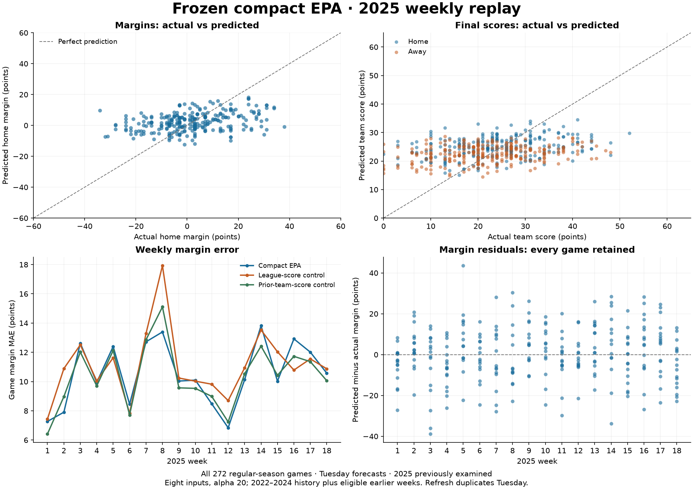

# Frozen compact-EPA 2025 weekly diagnostic

All 272 regular-season games; 18 Tuesday fits on expanding 2022–2025 history. Eight inputs and alpha 20 were fixed from development. No 2025 tuning or model selection.

2025 was previously examined in this project; this is not an untouched holdout. The enriched replay stays gated and the published app model is unchanged.

Early-week and refresh scores are identical because all compact inputs and coefficients stay Tuesday-locked. Metrics count each game once; score error counts 544 team scores.

| model | games | margin_mae | score_mae | total_mae | margin_rmse | margin_bias |
| --- | --- | --- | --- | --- | --- | --- |
| compact_epa | 272 | 10.508 | 7.635 | 10.817 | 13.318 | 0.224 |
| league_scores | 272 | 11.059 | 7.876 | 10.999 | 14.160 | 0.172 |
| prior_team_scores | 272 | 10.338 | 7.520 | 10.688 | 13.132 | 0.020 |

Compact EPA improves margin MAE by 0.551 points versus the league control, but is
0.171 points worse than the prior-team-score control. Both paired ranges below
include zero. This replay does not justify promoting compact EPA over that scoring
control or replacing the published model. The development margin MAE was 10.335;
the 2025 diagnostic is 10.508, a 0.173-point increase.

Positive paired gain means compact EPA has lower margin MAE than the control. Week-block bootstrap ranges describe 18 weekly blocks; they are not promotion rules.

| control | margin_mae_gain | week_block_95_lower | week_block_95_upper |
| --- | --- | --- | --- |
| league_scores | 0.551 | -0.071 | 1.230 |
| prior_team_scores | -0.171 | -0.499 | 0.182 |

The kickoff-plus-24-hour assumption can exclude Monday games at Tuesday's lock. Fold receipts list exclusions, training counts and hashes. Historical source revisions and publication times are not reconstructed.

Week 1 uses all 815 completed 2022–2024 games. Week 18 uses 1,070 training games,
including 255 from earlier 2025 weeks. Across the 18 Tuesday locks, 21 earlier-game
slots are excluded by the availability bound. They become eligible at a later lock;
no same-week results enter a refresh fit.

The charts show much narrower predictions than realized results: predicted margin
standard deviation is 5.950 points versus 14.177 for actual margins. Conditional
mean forecasts naturally have less variation than realized games; this difference
alone does not prove underfitting or justify stretching predictions. The 49 games
with actual margins of at least 21 points contribute 37.9% of absolute margin error
(22.135 MAE in that descriptive group versus 7.953 in the other 223 games).
These outcome-defined groups explain where errors occur; they are not usable
pregame categories or grounds for dropping games.

The next planned study should compare the frozen EPA reference, a points-based
opponent-adjusted model inspired by the available PEM description, and their
prespecified combination. Its feature, regularization and selection decisions
should use development years; 2025 remains an already-examined diagnostic. In
particular, this replay supports testing whether opponent-adjusted point production
adds information beyond EPA, without assuming extra parameters will help.

Interactive [predicted-versus-actual charts](comparison.html), all [game predictions](predictions.csv), and [weekly metrics](weekly_metrics.csv) are saved. Charts load Plotly from its CDN; local parquet artifacts contain only 2025 rows.

The curated prediction CSV contains one compact forecast per game at Tuesday's
cutoff (272 rows); refresh scores are identical. The ignored local parquet panel
and default CLI export retain all three methods and both horizons (1,632 rows).
The report JSON preserves source hashes, the actual freeze timestamp, runtime,
all fold receipts and metrics. No training tables or raw data were copied.

Validation: all 252 tests pass, including 18 new replay checks; Ruff, formatting
and mypy pass. The protocol/evaluator commit preceded the real replay. A second
offline command verifies and reuses the completed artifact without refitting.
