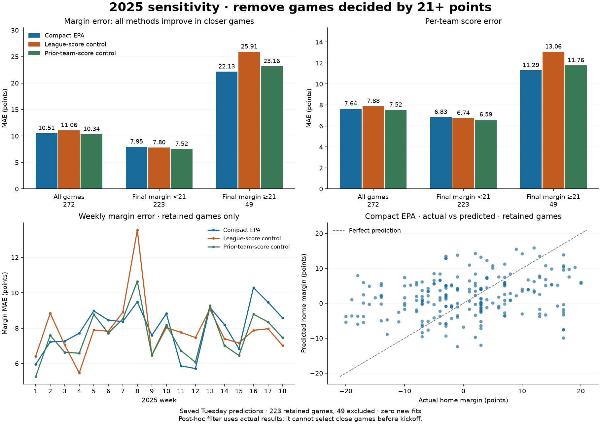

# 2025 sensitivity: exclude actual final margins of 21+

Saved frozen forecasts, no retraining. Identical games are selected for every method. The excluded group includes wins by exactly 21 points, for either team. Refresh duplicates Tuesday scores and is reported separately in the data.

The filter retains **223/272 games (82.0%)** and excludes **49 (18.0%)**.
Compact EPA's margin MAE falls from **10.508 to 7.953**, a **24.3% reduction**.
Its team-score MAE falls from 7.635 to 6.833, while total-score MAE rises slightly
from 10.817 to 11.008. All-game results are reproduced exactly from the original report.

The closer-game subset is easier for every method. Compact EPA trails both controls
on retained-game margin MAE: 7.953 versus 7.796 for league scores and 7.520 for prior
team scores. Its disadvantage to the prior-team-score control grows from 0.171 to
0.434 points. On this retrospective subset, the paired week-block range for that
gain is -0.741 to -0.096; it favors the scoring control, subject to the post-hoc
conditioning and limited 18-week sample.

EPA performs best of the three methods on the **excluded blowouts**, with margin
MAE 22.135 versus 25.910 and 23.161. Removing those games therefore removes the
part of this season where EPA has its strongest relative advantage. The lower
retained MAE does not show an overlooked advantage over these controls.

| subset | model | games | margin_mae | score_mae | total_mae | margin_rmse |
| --- | --- | --- | --- | --- | --- | --- |
| all_games | compact_epa | 272 | 10.508 | 7.635 | 10.817 | 13.318 |
| all_games | league_scores | 272 | 11.059 | 7.876 | 10.999 | 14.160 |
| all_games | prior_team_scores | 272 | 10.338 | 7.520 | 10.688 | 13.132 |
| actual_margin_under_21 | compact_epa | 223 | 7.953 | 6.833 | 11.008 | 9.804 |
| actual_margin_under_21 | league_scores | 223 | 7.796 | 6.737 | 11.098 | 9.655 |
| actual_margin_under_21 | prior_team_scores | 223 | 7.520 | 6.588 | 10.835 | 9.267 |
| actual_margin_21_or_more | compact_epa | 49 | 22.135 | 11.288 | 9.947 | 23.390 |
| actual_margin_21_or_more | league_scores | 49 | 25.910 | 13.061 | 10.547 | 26.245 |
| actual_margin_21_or_more | prior_team_scores | 49 | 23.161 | 11.760 | 10.018 | 23.800 |

Positive paired margin gain favors compact EPA. Week-block 95% ranges are descriptive for this outcome-selected subset; they are not independent evidence of pregame selection skill.

| subset | control | margin_mae_gain | week_block_95_lower | week_block_95_upper |
| --- | --- | --- | --- | --- |
| all_games | league_scores | 0.551 | -0.071 | 1.230 |
| all_games | prior_team_scores | -0.171 | -0.499 | 0.182 |
| actual_margin_under_21 | league_scores | -0.157 | -0.790 | 0.523 |
| actual_margin_under_21 | prior_team_scores | -0.434 | -0.741 | -0.096 |
| actual_margin_21_or_more | league_scores | 3.776 | 2.040 | 5.526 |
| actual_margin_21_or_more | prior_team_scores | 1.027 | 0.088 | 1.926 |

The original all-game primary evaluation is preserved. This outcome-defined filter is unavailable before kickoff; it cannot justify replacing the full-season MAE or treating these as forecasts of close games. The enriched replay remains gated.



The [interactive comparison](comparison.html) includes game IDs on hover and weekly
retained-game errors. [Metrics](metrics.csv) retain both forecast horizons, all
three groups, MAE/RMSE and bias for scores, margins and totals. The excluded group
contains games in 17 weeks; its paired bootstrap uses those observed week blocks.
Both other groups cover all 18 weeks. Positive bootstrap gains favor EPA.

Reproduce from the existing verified cache:

```powershell
.\.venv\Scripts\python.exe -m nfl_prop_model.modeling.team_margin_sensitivity
```

Output defaults to ignored `reports/local/team_margin_sensitivity/`. No estimator is
fitted, no raw/training datasets are copied, and the original frozen source hashes
are retained in [results.json](results.json). Four targeted checks cover the exact
21-point boundary, identical cohorts, weighted reconstruction of full-season MAE,
missing/inconsistent data and an empty excluded group.
