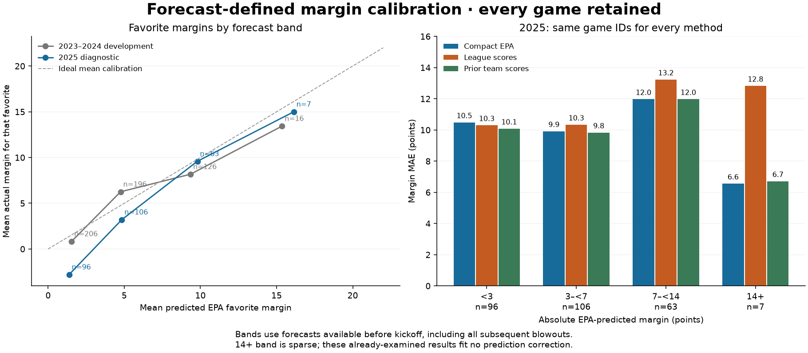

# Forecast-defined margin calibration

Every game retained; bands use Tuesday EPA forecasts, not actual results. Same games for every method. No prediction correction or model fit. Development and 2025 were already examined; these are descriptive diagnostics.

EPA is approximately mean-calibrated in development: slope **0.974**, with a
week-block range **0.764 to 1.212**. The 2025 slope is **0.825**, range **0.524 to
1.145**. Both include 1.0; the observed narrow spread of projections does not by
itself justify stretching margins. No slope or band correction was applied.

In 2025 the EPA favorite won 41.9% of 93 non-tied forecasts below three points,
59.4% of 106 forecasts at 3–<7, 74.6% of 63 at 7–<14, and all seven at 14+.
These are descriptive fractions, not calibrated future win probabilities or a
validated rule to reverse small favorites. Three predicted ties remain in the
96-game smallest band's score errors. The seven-game largest band is sparse.

| band | model | games | margin_mae | within_7 |
| --- | --- | --- | --- | --- |
| 3_to_under_7 | compact_epa | 106 | 9.918 | 0.387 |
| 0_to_under_3 | compact_epa | 96 | 10.485 | 0.510 |
| 7_to_under_14 | compact_epa | 63 | 11.975 | 0.365 |
| 14_or_more | compact_epa | 7 | 6.557 | 0.857 |
| 3_to_under_7 | league_scores | 106 | 10.338 | 0.396 |
| 0_to_under_3 | league_scores | 96 | 10.300 | 0.490 |
| 7_to_under_14 | league_scores | 63 | 13.233 | 0.381 |
| 14_or_more | league_scores | 7 | 12.829 | 0.286 |
| 3_to_under_7 | prior_team_scores | 106 | 9.835 | 0.434 |
| 0_to_under_3 | prior_team_scores | 96 | 10.081 | 0.500 |
| 7_to_under_14 | prior_team_scores | 63 | 11.976 | 0.349 |
| 14_or_more | prior_team_scores | 7 | 6.714 | 0.429 |

## Descriptive calibration

| period | model | games | predicted_margin_sd | intercept | slope | slope_week_block_95_lower | slope_week_block_95_upper |
| --- | --- | --- | --- | --- | --- | --- | --- |
| development | league_scores | 544 | 0.174 | None | None | None | None |
| development | prior_team_scores | 544 | 3.845 | -0.653 | 1.426 | 1.130 | 1.738 |
| development | compact_epa | 544 | 5.678 | -0.056 | 0.974 | 0.764 | 1.212 |
| 2025 | compact_epa | 272 | 5.950 | 0.177 | 0.825 | 0.524 | 1.145 |
| 2025 | league_scores | 272 | 0.060 | None | None | None | None |
| 2025 | prior_team_scores | 272 | 4.087 | -0.721 | 1.336 | 0.927 | 1.768 |

An ideal mean-calibration slope is 1 with intercept 0. Ranges use resampled season/week blocks and do not account for earlier adaptive exploration. Near-constant forecasts have no reported slope. Empty bands remain in coverage.csv. Sparse bands and forecast ties must not be interpreted as established confidence levels.

[Interactive chart](comparison.html). Favorite statistics orient actual margins toward the EPA favorite; predicted ties are excluded only from favorite summaries. All score errors retain them. Early and refresh results are separate duplicate forecasts, not independent evidence. The enriched replay remains gated.

Band counts in the figure include predicted ties; favorite means exclude them.
The [coverage table](coverage.csv) retains empty bands and the [full band table](bands.csv)
includes the exact favorite denominators, score/total metrics and error coverage.
Reproduce offline with `python -m nfl_prop_model.modeling.team_margin_calibration`.
