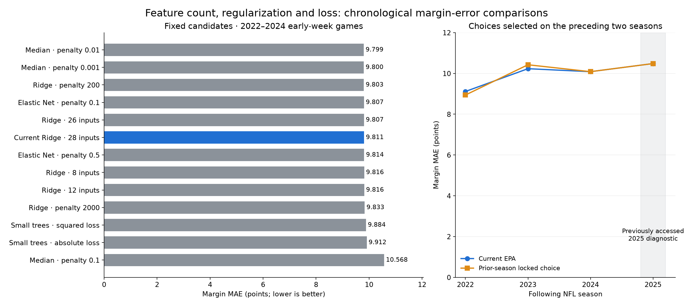

# Feature and model refinement: result

October 14, 2026. Parameter redundancy is worth investigating, especially in the expanded
play/SOS experiment, but these comparisons do not establish it as the main cause of high
margin error. Retain the current forecast model. Smaller models nearly match its accuracy;
the tested alternatives do not reliably reduce margin MAE.

## Methods and audit

See [methods](methods.md) for the distinctions between inputs, fitted parameters and tuning
settings, common reduction/regularization methods and the pre-2025 correlation audit.
The current model uses 28 raw / 29 encoded inputs and 60 fitted scalar coefficients/intercepts.
The earlier play/SOS expansion uses 60 raw / 89 encoded inputs and 180 coefficients/intercepts,
with rank 66 and many duplicate missing indicators. Both audit fits use 2,367 earlier games.
Ridge already reduces effective fitting complexity; counts alone do not prove overfitting.

## Fixed candidate comparisons

Same 815 early-week games from 2022–2024; no difficult games removed.

| Candidate | Raw inputs | Early margin MAE | Early score MAE | Early total MAE |
|---|---:|---:|---:|---:|
| Current Ridge, penalty 20 | 28 | 9.811 | 7.333 | 10.538 |
| Compact Ridge | 12 | 9.816 | 7.320 | 10.533 |
| Compact season-only Ridge | 8 | 9.816 | 7.316 | 10.510 |
| Ridge without history counts | 26 | 9.807 | 7.314 | 10.501 |
| Stronger Ridge, penalty 200 | 28 | 9.803 | 7.323 | 10.530 |
| Stronger Ridge, penalty 2000 | 28 | 9.833 | 7.322 | 10.532 |
| Elastic Net, penalty 0.1 | 28 | 9.807 | 7.319 | 10.519 |
| Elastic Net, penalty 0.5 | 28 | 9.814 | 7.311 | 10.504 |
| Median margin/total, penalty 0.1 | 8 | 10.568 | 7.653 | 10.688 |
| Median margin/total, penalty 0.01 | 8 | 9.799 | 7.292 | 10.488 |
| Median margin/total, penalty 0.001 | 8 | 9.800 | 7.313 | 10.488 |
| Small trees, squared loss | 8 | 9.884 | 7.341 | 10.535 |
| Small trees, absolute loss | 8 | 9.912 | 7.345 | 10.452 |

The eight-input Ridge allocates 20 weights/intercepts rather than 60, while margin MAE
changes by only 0.005 points. This supports simplification as a plausible maintainability
choice, rather than a demonstrated error-reduction fix.

The initial eleven-profile round found the median penalty 0.1 left only one active encoded
input in the pre-2025 training audit. The two weaker penalties are an explicit adaptive
development follow-up, preserving the initial result in `round1_summary.json` and exact
initial source/manifests locally. At 0.01 and 0.001 the corresponding audits retain seven
and eight encoded inputs. Weakening the penalty resolves that observed underfitting, but
the best fixed gain is only 0.012 margin points; it is not a meaningful validated breakthrough.
Different estimators normalize their objectives differently, so their numerical penalties
are not directly comparable. Median targets are margin and total; reconstructed scores are
derived forecasts, not a claim about conditional mean or median individual team scores.

## Choices using preceding seasons only

All thirteen profiles use chronological training. Select on the prior two early-week
seasons, with score/total guards, a 0.05-point minimum margin gain and a one-standard-error
simplicity heuristic. Complexity is fitted from available pre-season training games.
Lock the choice for both timings throughout the following season; refit only on earlier
available outcomes. Do not select on the following season's results.

| Following season | Selected profile | Prior validation gain | Following early margin MAE |
|---|---|---:|---:|
| 2022 | Median penalty 0.01, 8 inputs | 0.093 | 8.940 |
| 2023 | Median penalty 0.01, 8 inputs | 0.069 | 10.424 |
| 2024 | Current EPA | 0.000 | 10.085 |
| 2025 | Current EPA | 0.000 | 10.483 |

Across 2022–2024, the locked policy yields early/refresh margin MAE **9.818/9.814**, versus
current EPA **9.811/9.805**. Score MAE improves modestly to **7.286/7.289**, versus
**7.333/7.331**, and total MAE to **10.454/10.459**, versus **10.538/10.523**. Margin errors
do not improve. Approximate paired season-week gain ranges include zero; these do not
support promotion for the primary margin objective. 2025 retains current EPA exactly.
The small validation advantage in prior seasons is not stable in following seasons.

## Interpretation and next tests

- More inputs can be redundant; fewer inputs can match performance. Neither result shows
  that parameter count explains the full 9–10-point MAE. The current model has few fitted
  parameters relative to its rows, though repeated teams/time dependence limit simple
  sample-size rules. Focus on later-game performance and parameter stability.
- Small nonlinear trees fit earlier training better but do not improve these chronological
  candidate margin errors. Absolute-loss models are sensitive to penalty strength and
  feature choice; the initial overly strong median result is not evidence against the loss.
- Keep the compact models as research baselines for a small, well-sourced starter-change
  layer. Systematic pre-cutoff starter/replacement evidence, past special-teams/pace measures
  and earlier-residual interval calibration remain separate tests. This round does not
  claim to have rebuilt those data sources or verified complete starter coverage.
- Stop expanding a search simply to find a favorable retrospective result. A selected
  revision needs later prospective scoring. 2022–2024 remain examined development and
  2025 is already accessed diagnostic data; simulated locks do not create a new holdout.

## Verification and provenance

All 6,522 league/prior-score/current-EPA control predictions match the original development
and 2025 diagnostic outputs exactly. All 1,087 games per horizon are retained, and scores,
signed margins and totals share the common rounding/nonnegative rule. The research command
uses a separate cache namespace and does not change published forecasts.

Six new tests cover all estimator families, default-control equivalence, complexity,
unavailable/overlapping/future data, simpler prior-only selection, coherent scores, complete
cohorts, CLI/cache checksums and code guards. The final full suite passes all **402** tests;
Ruff, formatting, strict typing and dependency checks pass.
The initial full run passed 401 with one legacy enrollment snapshot guard failure.
Post-failure source/code/freshness comparisons matched and all 14 participation checks
passed in isolation. The final full run passes with the guard unchanged; the transient
failure's cause is not established. Existing local native Polars diagnostics remain recorded;
no handlers or tests are disabled.

Exact metrics, selections, audits, source/code hashes and approximate paired gains are in
`summary.json`; the initial round is in `round1_summary.json`. Reproduce the complete local
report and predictions with `nfl-prop team-refine`. Raw datasets and detailed local artifacts
remain ignored.
