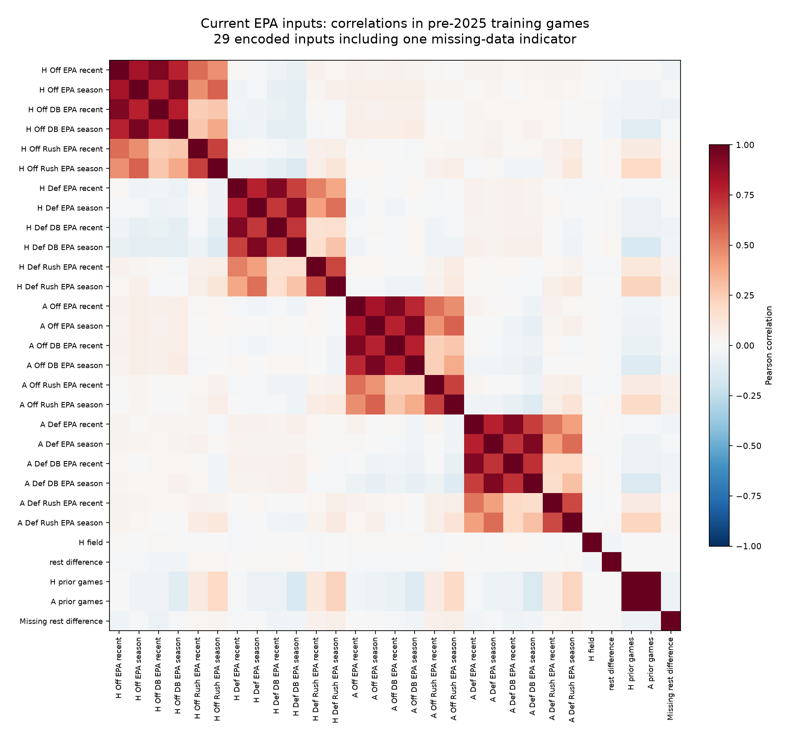

# Refining feature and parameter usage

October 14, 2026. Feature count, learned parameters and hyperparameters are different.
Features are inputs (EPA, rest, etc.); learned parameters are fitted weights/intercepts;
hyperparameters control the fitting algorithm (penalty strength, leaf count, depth).
The important question is whether extra flexibility improves predictions on later games.

## Standard methods and their role here

| Method | How it helps | NFL application |
|---|---|---|
| Ridge/L2 shrinkage | Reduces weight magnitudes without deleting inputs | Existing model; test stronger penalties |
| Lasso/L1 and Elastic Net | Can zero coefficients; Elastic Net combines shrinkage and sparsity | Fit joint score targets with correlated EPA measures |
| Group ablation, correlation filtering, RFE/sequential selection | Removes inputs and compares predictive performance | Begin with coherent recent/season and split-rate groups |
| Validation permutation importance | Measures performance loss when inputs are disturbed | Inspect held-out chronological data; correlated inputs can mask one another |
| PCA/component reduction | Combines inputs into fewer dimensions | Optional later test; components make individual EPA inputs harder to explain |
| Tree complexity controls | Restrict depth, leaves and minimum examples per leaf | Small trees with explicit limits; no random early-stopping split |
| Chronological validation and a simplicity rule | Compares errors on later games; avoids choosing extra complexity for a tiny gain | Prior two seasons, score/total guards, one-standard-error preference |

These are common method families, not a survey-based popularity ranking. References:
[linear methods](https://scikit-learn.org/stable/modules/linear_model.html),
[feature-selection methods](https://scikit-learn.org/stable/modules/feature_selection.html),
[permutation and correlated features](https://scikit-learn.org/stable/auto_examples/inspection/plot_permutation_importance_multicollinear.html),
[PCA](https://scikit-learn.org/stable/modules/generated/sklearn.decomposition.PCA.html),
[tree/loss controls](https://scikit-learn.org/stable/modules/generated/sklearn.ensemble.HistGradientBoostingRegressor.html),
[simpler models within validation uncertainty](https://scikit-learn.org/stable/auto_examples/model_selection/plot_grid_search_refit_callable.html).

## What the audit found before the 2025 cutoff

Both models have the same 2,367 earlier training games; later outcomes are excluded.

| Model | Raw inputs | Encoded inputs | Allocated weights/intercepts | Matrix rank | Ridge effective df per score |
|---|---:|---:|---:|---:|---:|
| Current EPA | 28 | 29 | 60 | 29 | 24.63 |
| EPA + play tendencies + strength/SOS | 60 | 89 | 180 | 66 | 59.16 |

Encoding adds missing-data indicators. In the expanded experiment, several indicators
repeat the same missing-history condition. Its 89-column matrix has only 66 independent
directions. There are nine encoded pairs with absolute correlation at least 0.9 in the
current model, versus 299 in the expanded version, many involving those duplicate indicators.
The current model is not a huge unrestricted network. Ridge already limits its effective
flexibility; neither the counts nor correlations alone prove overfitting. The previously
observed worsening after adding features supports testing pruning and shrinkage explicitly.

Ridge effective df is a fitting-complexity measure, not the literal number of retained inputs.
Correlated features may still be useful; a correlation threshold is not sufficient reason
to delete them. Learn preprocessing and selection inside training periods. Do not fit PCA,
choose variables or tune penalties using the evaluated season's outcomes.

## Tests now implemented

- 8/12/26/28-input Ridge feature groups and penalties 20/200/2000.
- Two joint Elastic Net penalties, with convergence checks and active-input audits.
- Median margin/total regression, plus squared/absolute-loss small boosted trees on eight inputs.
  The initial median penalty 0.1 left only one active input in the pre-2025 training audit;
  penalties 0.01 and 0.001 are a recorded follow-up to test that underfitting. The initial
  eleven-profile comparison is preserved in `round1_summary.json`; this is adaptive
  development, with no fresh-holdout claim.
- Season-locked chronological selection with a simpler-model preference and final-score/total guards.
- Original control equality, complete cohorts, source/code/checksum guards, future-data exclusion
  and consistent projected scores/margins.

Starter/replacement announcements, special-teams data and forecast intervals remain separate
data/calibration tests. The prior generic injury experiment does not establish complete
forecast-time starter coverage. Systematic timestamped evidence is needed before attributing
an aggregate accuracy gain to a starter adjustment. This round isolates feature redundancy,
regularization, loss and modest nonlinear effects using the existing EPA inputs.

The 2022–2024 periods are examined development seasons and 2025 is already accessed diagnostic
data. No fresh-holdout claim or automatic forecast promotion follows from these tests.
