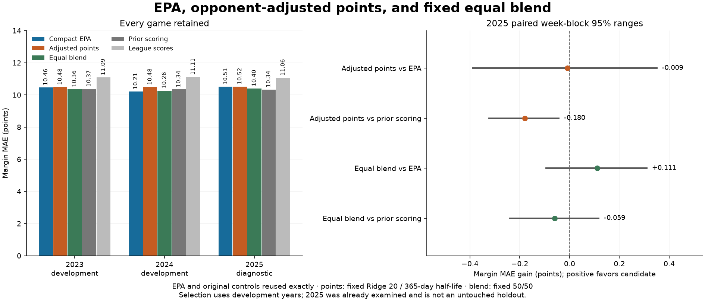

# EPA, opponent-adjusted points, and equal blend

PEM-inspired transparent scoring ratings, not a reconstruction of the original PEM. All games retained. EPA and both original controls are reused exactly. The blend has fixed 50/50 score weights. 2025 is already-examined diagnostic data.

2023-only choice for 2024: **compact_epa**. Development-only frozen 2025 research choice: **compact_epa**.

The equal blend improves 2025 margin MAE from 10.508 to **10.397**, but trails the
prior-scoring control at **10.338**. Its EPA gain is 0.111 points, with an approximate
paired week-block range **-0.093 to +0.310**. Points alone has MAE **10.517**.
This is limited evidence of complementary information; it does not establish a
dependable margin improvement or justify changing the frozen choice.

The blend's development gain is just **0.026** versus EPA and **0.047** versus prior
scoring, failing the 0.05 requirement and positive-range guards. It also worsens
2024 team-score MAE by 0.110 versus EPA, exceeding the 0.05 guard. The points model
loses to prior scoring in development and 2025. Both development selection records
therefore retain EPA; no 2025 ranking changes the decision or blend weight.

| season | model | games | margin_mae | score_mae | total_mae |
| --- | --- | --- | --- | --- | --- |
| 2023 | compact_epa | 272 | 10.461 | 7.557 | 10.633 |
| 2024 | compact_epa | 272 | 10.209 | 7.209 | 9.925 |
| 2025 | compact_epa | 272 | 10.508 | 7.635 | 10.817 |
| 2023 | epa_points_blend | 272 | 10.359 | 7.487 | 10.540 |
| 2024 | epa_points_blend | 272 | 10.260 | 7.319 | 9.876 |
| 2025 | epa_points_blend | 272 | 10.397 | 7.538 | 10.658 |
| 2023 | league_scores | 272 | 11.091 | 7.775 | 10.718 |
| 2024 | league_scores | 272 | 11.114 | 7.799 | 10.098 |
| 2025 | league_scores | 272 | 11.059 | 7.876 | 10.999 |
| 2023 | points_ratings | 272 | 10.485 | 7.550 | 10.518 |
| 2024 | points_ratings | 272 | 10.483 | 7.505 | 10.031 |
| 2025 | points_ratings | 272 | 10.517 | 7.569 | 10.662 |
| 2023 | prior_team_scores | 272 | 10.371 | 7.515 | 10.519 |
| 2024 | prior_team_scores | 272 | 10.341 | 7.414 | 9.980 |
| 2025 | prior_team_scores | 272 | 10.338 | 7.520 | 10.688 |

Positive paired gains favor the candidate. All ranges are adaptive research diagnostics, not fresh holdout evidence. No app-model promotion or enriched replay gate change.

| period | model | control | margin_mae_gain | week_block_95_lower | week_block_95_upper |
| --- | --- | --- | --- | --- | --- |
| development | points_ratings | compact_epa | -0.149 | -0.401 | 0.112 |
| development | points_ratings | prior_team_scores | -0.128 | -0.234 | -0.013 |
| development | epa_points_blend | compact_epa | 0.026 | -0.103 | 0.161 |
| development | epa_points_blend | prior_team_scores | 0.047 | -0.072 | 0.170 |
| 2025 | points_ratings | compact_epa | -0.009 | -0.389 | 0.350 |
| 2025 | points_ratings | prior_team_scores | -0.180 | -0.323 | -0.043 |
| 2025 | epa_points_blend | compact_epa | 0.111 | -0.093 | 0.310 |
| 2025 | epa_points_blend | prior_team_scores | -0.059 | -0.239 | 0.117 |

Scores share the original nonnegative tenths contract. Ratings are in points: own offense minus defense-conceded is power; home advantage is the signed venue coefficient. Team indicators are unscaled; the same alpha number does not imply the same regularization strength as scaled EPA. No penalty/recency/blend-weight search.

[Forecast-band calibration](calibration.html), [2025 candidate scores](candidate_2025.csv), [metrics](metrics.csv), and [source/fit/freeze receipts](results.json). Refresh duplicates Tuesday predictions. Missing rosters/starters remain unresolved.

The actual-outcome breakdown remains descriptive and uses common game IDs:

| 2025 margin MAE | EPA | Adjusted points | Equal blend | Prior scoring |
|---|---:|---:|---:|---:|
| Actual margin below 21 (223 games) | 7.953 | 7.607 | 7.637 | 7.520 |
| Actual margin 21+ (49 games) | 22.135 | 23.761 | 22.957 | 23.161 |

The blend improves on EPA in the closer-outcome group but gives up some EPA
performance on blowouts. Neither group can be selected from the final result
before kickoff. All-game margin error remains primary. The [outcome groups](outcome_groups.csv)
also retain score/total errors for both horizons and development years.

The points model allocates **66** coefficients/intercept, including 32 offense and
32 defense indicators and the venue coefficient. Its effective degrees of freedom
are **21.68, 27.63 and 30.01** at the 2023, 2024 and 2025 opening fits. Earlier EPA
audits allocate 20 scalar weights/intercepts. The blend reuses both components
(86 allocated scalars in total) and adds no fitted combination weights; zero new
blend parameters does not make it a smaller model than EPA alone.

Exactly **36 development and 18 diagnostic points fits** are saved. The protocol
and source commit preceded candidate fits; the separate development-only choice
was recorded before the 2025 candidate fits. All **4,896** original control forecast
rows across 816 games, three methods and two horizons are retained exactly. The
complete five-method panel has 8,160 rows, with no per-fit training-table copies.
The original source/model hashes and enriched gate remain intact.

Run `python -m nfl_prop_model.modeling.team_points_comparison` against the existing
cache. The reader checks source/input hashes, frozen choices, source game facts,
training fingerprints, saved coefficients, reconstructed candidate forecasts,
controls and recomputed summaries without fitting again. No new source download
or environment was needed. All 272 tests pass in Windows/Linux CI, including the
16 new calibration/comparison checks.
